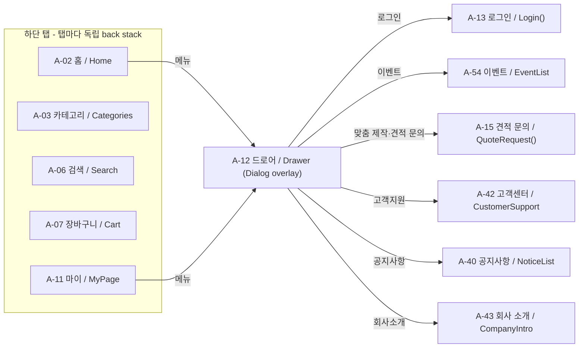
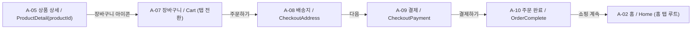
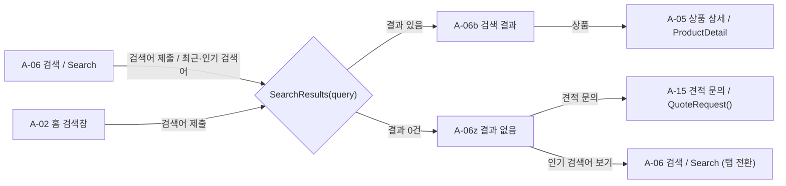
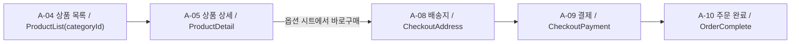
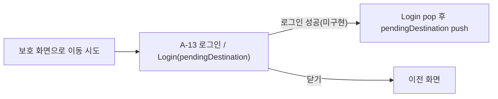
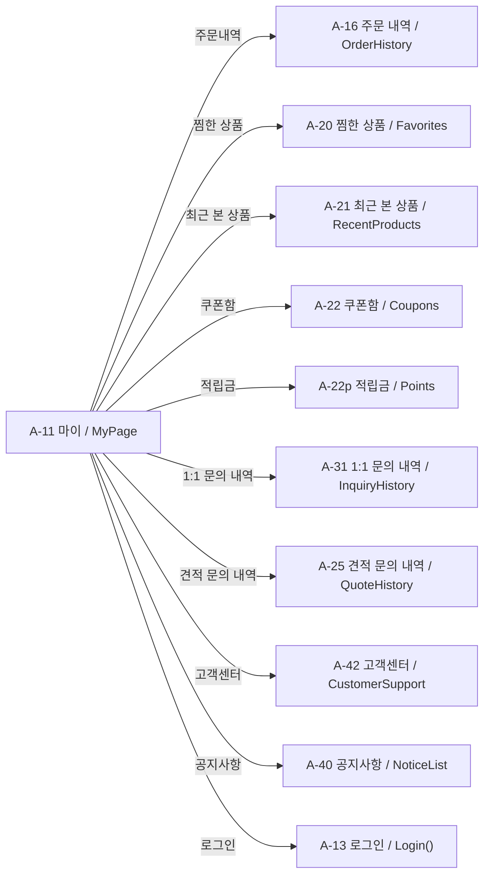
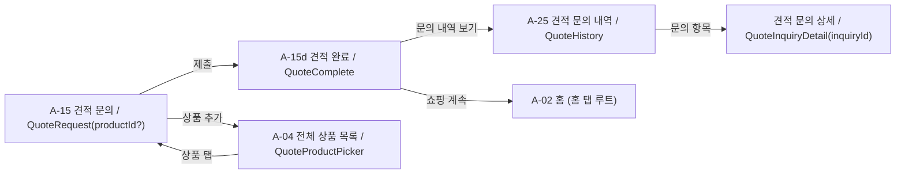
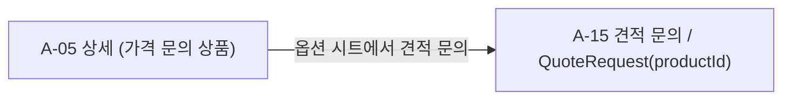

# 앱 화면 흐름 (Navigation 3)

- 근거: Figma `01 IA & Flow`(node `72:3`)의 하단 탭·드로어·F1~F7 정의, 그리고 실제 코드
  `app/src/main/java/com/nativelap/eumshoppingmall/navigation/` (`EumDestination`, `EumMainNavigator`, `EumMainNavDisplay`, `EumMenuDestinations`).
- 노드 표기: `A-xx 화면명 / EumDestination 이름`.
- 작성: Issue #27 (2026-11-09).

## 구조 요약

- 단일 `NavDisplay`(`EumMainNavDisplay`) 하나가 모든 화면을 그린다.
- 하단 탭 5개가 각자 back stack을 가진다. 현재 탭은 `MainNavigationTab` ordinal(Int)로 저장한다.
- 탭 전환 시 각 탭의 기록이 유지된다. 이미 선택된 탭을 다시 누르면 그 탭의 루트로 돌아간다.
- 뒤로가기 규칙
  - 탭 안에 쌓인 화면이 있으면 한 단계 pop한다.
  - 홈이 아닌 탭의 루트에서는 홈 탭으로 전환한다(앱 종료 아님).
  - 홈 탭 루트에서는 시스템 뒤로가기(앱 종료)로 넘긴다.
- 드로어(A-12)는 `DialogSceneStrategy` overlay로 현재 화면 위에 뜬다. 배경 dim은 화면이 디자인 토큰(`eumColors.dim`)으로 그리고, Dialog 창 기본 dim은 `AccountDrawerRoute`에서 끈다.
- 하단 바 선택 표시는 현재 탭이 아니라 그 화면이 속한 탭으로 정한다. 탭 루트는 자기 탭, push된 화면은 소속 탭 back stack의 탭이다(`LocalEumOwnerTab`). 탭 전환·predictive back 중에 사라지는 화면의 하단 바가 미리 바뀌지 않게 하기 위해서다.

### 스킬 예외

1. **단일 NavDisplay + 로그인 push**: `android-navigation` 스킬의 기본 구조는 로그인 전 Auth NavDisplay와 로그인 후 Main NavDisplay를 나누는 것이다. 이 앱은 비로그인 상태에서도 홈·검색·장바구니를 쓰고, 로그인은 보호된 화면 앞에서만 요구한다. 그래서 `Login(pendingDestination)`을 현재 탭 위에 push하고, 로그인 성공 시 pop한 뒤 보류된 목적지를 push하는 구조(F4)를 택했다. 로그인 성공 처리는 아직 구현하지 않았다.
2. **화면 안 시트·다이얼로그 유지**: 옵션 시트(A-05s), 배송 요청 선택 메뉴(A-08), 설정 다이얼로그(A-35l), 탈퇴 다이얼로그(A-26c) 등은 NavKey overlay가 아니라 기존처럼 각 Screen/Route의 내부 상태로 연다. overlay 목적지로 옮기는 일은 후속 이슈에서 다룬다.

## 하단 탭과 드로어

드로어 메뉴를 고르면 드로어 항목을 그 목적지로 바꾼다(`replaceTop`). 그래서 메뉴 화면에서 뒤로가면 드로어가 아니라 드로어를 연 화면으로 돌아간다.

## 연결한 흐름

### F1 장바구니 주문

A-10으로 갈 때 A-08·A-09를 스택에서 걷어 낸다. 그래서 A-10에서 뒤로가면 결제 화면이 아니라 장바구니로 돌아간다. "쇼핑 계속"은 A-10을 닫고, 홈 탭 기록을 루트만 남긴 뒤 홈 탭으로 전환한다(`closeTopAndOpenTabRoot`). 출발 탭과 상관없이 항상 홈 첫 화면이 보인다(사용자 결정, 2026-11-09).

### F2 검색

결과와 0건은 같은 NavKey이며, Route가 결과 유무로 화면을 고른다. 결과 화면에서 다시 검색하면 현재 결과 항목을 새 검색어로 바꾼다.
0건 화면의 "인기 검색어 보기"는 검색 탭으로 전환한다(`navigateToTab(Search)`). 이미 검색 탭에 있으면 검색 탭 루트로 돌아간다.
홈에서 연 0건 화면은 홈 탭 기록에 그대로 남으므로, 홈 탭으로 돌아오면 그 화면이 다시 보인다.

### F3 바로구매

### F4 비로그인 보호 화면 (구조만)

- 현재 로그인 진입점: 마이(A-11) 비로그인 카드의 "로그인 또는 회원가입", 드로어의 "로그인". 둘 다 `Login()`(보류 목적지 없음)이다.
- 장바구니 로그인 안내 배너는 클릭 동작이 없어 연결하지 않았다.
- `EumMainNavigator.completeLogin()`이 성공 후 처리를 담당하며, 단위 테스트로만 검증했다.

### F5 마이 1단계

바로가기(A-16·20·21·22·22p)와 메뉴 행(견적 문의 내역 A-25, 1:1 문의 내역 A-31)은 로그인한 마이 화면에만 보인다.
로그인 성공 경로가 없으므로 debug 샘플 제공자(`SampleShoppingScreenDataProvider`)만 `isLoggedIn = true`로 두어 실행 중에 확인한다. release는 비로그인 그대로다.
debug가 로그인 상태이므로 장바구니의 로그인 안내 배너와 드로어의 "로그인" 메뉴는 debug 실행 중에는 보이지 않는다.

마이 화면 ID 연결 현황(`EumMenuDestinations`):

| ID | 위치 | 연결 |
|---|---|---|
| `orders`, `favorites`, `recent`, `coupons`, `points` | 바로가기 | A-16, A-20, A-21, A-22, A-22p |
| `quotes`, `inquiries`, `customer`, `notices` | 메뉴 행 | A-25, A-31, A-42, A-40 |
| `profile` | 메뉴 행 "내 정보 관리" | 미연결(아래 제외 표) |
| `addresses` | 메뉴 행 "배송지 관리" | 미연결(아래 제외 표) |
| `returns` | 메뉴 행 "취소·반품·교환" | 미연결(아래 제외 표) |

### F6 견적 문의

A-15d로 갈 때 A-15를 스택에서 걷어 낸다. "문의 내역 보기"는 A-15d를 A-25로 바꾼다. "쇼핑 계속"은 A-10과 같이 홈 탭 루트로 간다.

**상품 추가(결과 반환)**: A-15의 "관심 품목 > 상품 추가"는 `QuoteProductPicker`를 push한다. 화면은 A-04 전체 상품 목록(`CatalogProductListRoute`)을 그대로 쓰고, 상품을 탭하면 상세로 가지 않고 바로 폼에 담는다(목록 Screen의 기존 `ProductSelected` 이벤트 하나로 처리되기 때문이다).
- navigation3 1.1.7에는 결과 반환 API가 없다. 그래서 내비게이션 계층의 `EumQuoteProductSelection`이 고른 상품 ID 하나를 `rememberSaveable`로 들고 있고, 선택 화면은 ID를 맡긴 뒤 pop만 한다. 다시 그려진 폼 Route가 그 ID를 자기 목록에 더하고 칸을 비운다.
- 이 방식을 고른 이유: NavKey에 UiModel을 싣지 않고(ID만 저장), back stack 항목을 바꿔 끼우지 않으며, Navigator는 push/pop만 한다. 선택 화면은 항상 폼 바로 위에 쌓이므로 결과를 받을 폼이 하나로 정해진다.
- 폼은 선택 화면에 다녀오는 동안 composition에서 빠지므로, 입력값(상품 ID 목록 포함)을 `rememberSaveable`에 저장 가능한 값으로만 보관한다. 이미 담긴 상품을 다시 고르면 중복으로 담지 않는다.
- 제출 조건은 기존 임시 규칙(연락처 4개 항목 + 개인정보 동의)을 그대로 쓴다. 접수 완료(A-15d) 화면의 내용은 고정 샘플이라 입력값을 반영하지 않는다.
A-15 진입점: 홈 견적 배너, 드로어, 장바구니 견적 버튼, 검색 0건, 견적 문의 상세의 "다시 요청".

### F7 금액 미표시 상품

## 제외한 흐름 (후속)

| 흐름 | 이유 |
|---|---|
| auth 하위(가입 A-14, 계정 찾기 A-27·28, 비밀번호·휴대폰 변경 A-29·30, 탈퇴 A-26) | 이번 범위 제외 |
| 로그인 성공 처리 | 인증 연동 없음 |
| 클레임 A-19·A-50~54 반려 변형, 주문 상세 A-17, 배송 조회 A-18 | 2단계 흐름 |
| 설정·약관 A-35~39, 알림 A-32 | 이번 범위 제외 |
| 마이 `profile` → 내 정보 관리 A-23 | 화면 진입 전 비밀번호 재확인 단계가 있어 인증 연동 없이 연결하지 않는다 |
| 마이 `addresses` → 배송지 관리 A-24 | 배송지 추가·수정 폼이 주소 검색(A-46) 결과 반환을 필요로 한다 |
| 마이 `returns` → 취소·반품·교환 A-19·A-50~54 | 주문 선택·사유 입력·결과로 이어지는 2단계 흐름이다 |
| 적립금 A-22p 필터별 목록, 쿠폰함의 적립금 바로가기 | 내역 항목에 적립·사용·소멸 구분 값이 없다. 쿠폰함 → 적립금 연결은 이번 지적 범위 밖 |
| 1:1 문의 상세·작성(A-31 하위) | 2단계 흐름 |
| 주소 검색 A-46, 배송 요청 A-47, 상품 필터 A-48 | 결과 반환이 필요 |
| 브랜드 A-33·34, 이벤트 상세 A-55, 공지 상세 A-41 | 2단계 또는 범위 밖 |
| 스플래시 A-01 | 화면에 완료 콜백 없음 |
| F2 네트워크 실패 | 해당 화면 없음 |
| 홈 히어로 버튼, 홈 카테고리 행 | 목적지 미정 또는 미사용 컴포넌트 |
