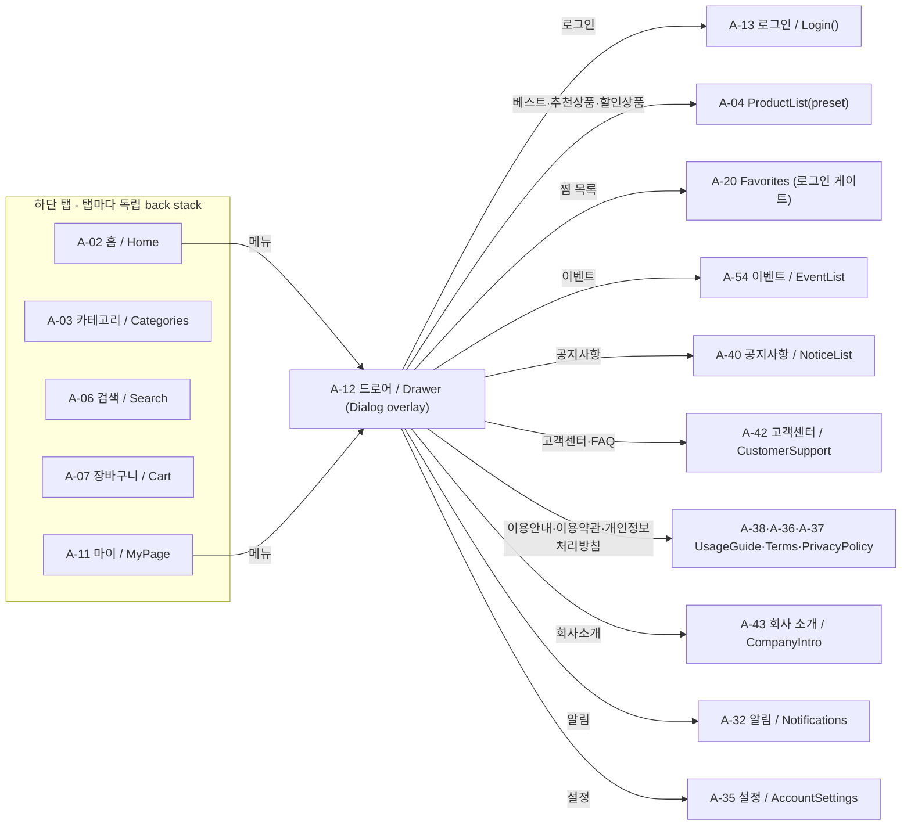
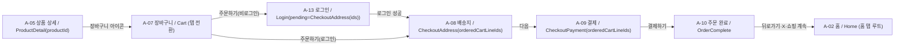
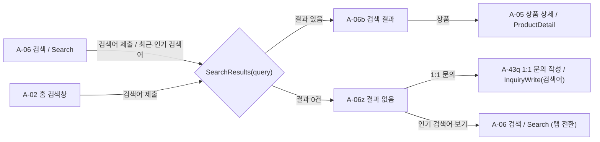
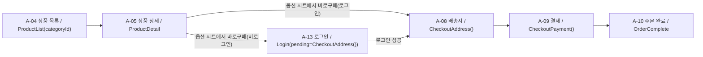
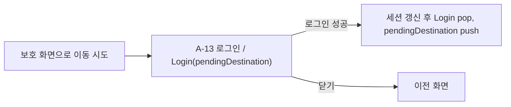
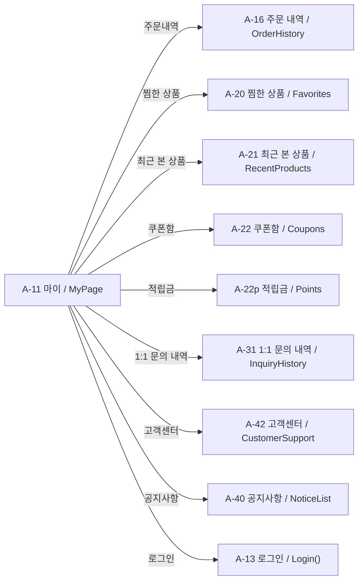
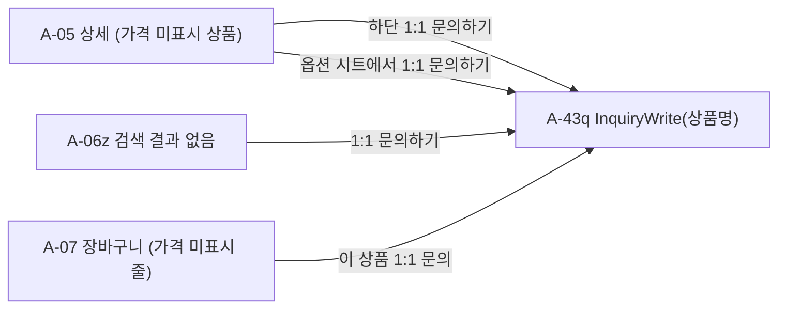
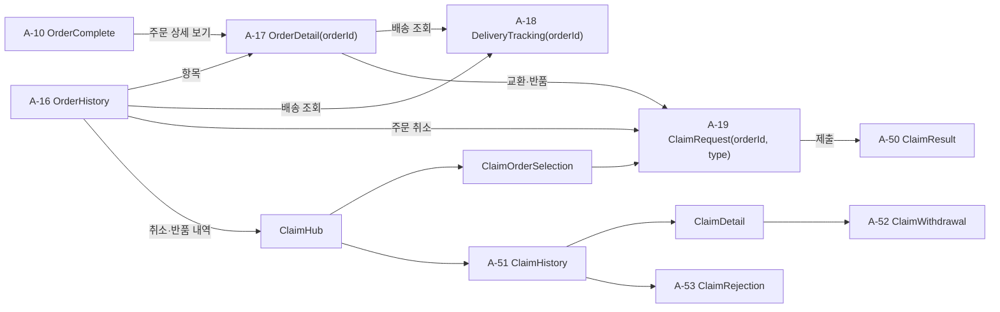
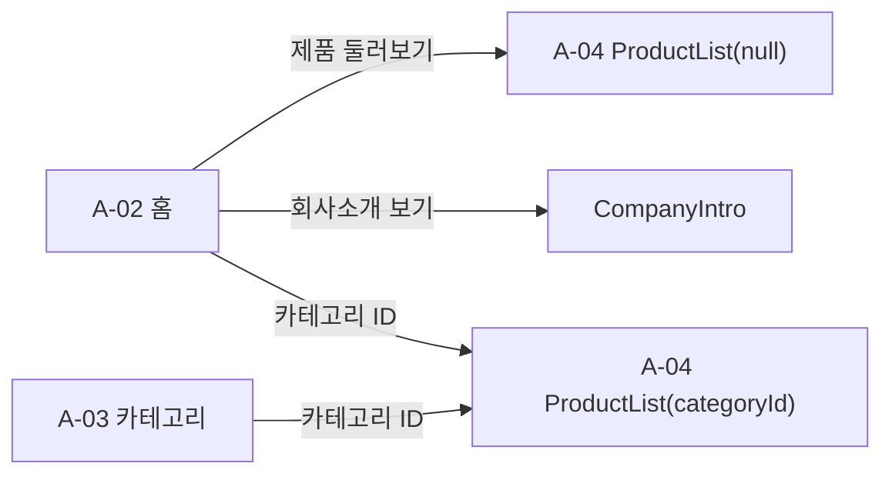

# 앱 화면 흐름 (Navigation 3)

- 근거: Figma `01 IA & Flow`(node `72:3`)의 하단 탭·드로어·F1~F7 정의, 그리고 실제 코드
  `app/src/main/java/com/nativelap/eumshoppingmall/navigation/` (`EumDestination`, `EumMainNavigator`, `EumMainNavDisplay`, `EumMenuDestinations`).
- 노드 표기: `A-xx 화면명 / EumDestination 이름`.
- 작성: Issue #27 (2026-11-09).
- 갱신: 2026-11-23 (이슈 #70). 상품 문의 제출을 준비 중 안내로 바꾸고, F13(상품 목록·홈 2차 범위)을 추가했다.

## 구조 요약

- 단일 `NavDisplay`(`EumMainNavDisplay`) 하나가 모든 화면을 그린다.
- 하단 탭 5개가 각자 back stack을 가진다. 현재 탭은 `MainNavigationTab` ordinal(Int)로 저장한다.
- 탭 전환 시 각 탭의 기록이 유지된다. 이미 선택된 탭을 다시 누르면 그 탭의 루트로 돌아간다.
- 뒤로가기 규칙
  - 탭 안에 쌓인 화면이 있으면 한 단계 pop한다.
  - 홈이 아닌 탭의 루트에서는 홈 탭으로 전환한다(앱 종료 아님).
  - 홈 탭 루트에서는 시스템 뒤로가기(앱 종료)로 넘긴다.
- 드로어(A-12)는 `DialogSceneStrategy` overlay로 현재 화면 위에 뜬다. 배경 dim은 화면이 디자인 토큰(`eumColors.dim`)으로 그리고, Dialog 창 기본 dim은 `AccountDrawerRoute`에서 끈다.
- 하단 바 선택 표시는 현재 탭이 아니라 그 화면이 속한 탭으로 정한다. 탭 루트는 자기 탭, push된 화면은 소속 탭 back stack의 탭이다(`LocalEumOwnerTab`). 탭 전환·predictive back 중에 사라지는 화면의 하단 바가 미리 바뀌지 않게 하기 위해서다(화면·탭 전환 애니메이션은 2026-11-23 삭제되어 전환은 즉시 일어난다).

### 스킬 예외

1. **단일 NavDisplay + 로그인 push**: `android-navigation` 스킬의 기본 구조는 로그인 전 Auth NavDisplay와 로그인 후 Main NavDisplay를 나누는 것이다. 이 앱은 비로그인 상태에서도 홈·검색·장바구니를 쓰고, 로그인은 보호된 화면 앞에서만 요구한다. 그래서 `Login(pendingDestination)`을 현재 탭 위에 push하고, 로그인 성공 시 pop한 뒤 보류된 목적지를 push하는 구조(F4)를 택했다. 인증 서버는 아직 없어 debug 빌드만 mock 로그인으로 성공하고, release는 "로그인 서비스 준비 중"을 안내한다.
2. **화면 안 시트·다이얼로그 유지**: 옵션 시트(A-05s), 배송 요청 선택 메뉴(A-08), 설정 다이얼로그(A-35l), 탈퇴 다이얼로그(A-26c) 등은 NavKey overlay가 아니라 기존처럼 각 Screen/Route의 내부 상태로 연다. overlay 목적지로 옮기는 일은 후속 이슈에서 다룬다.

### 사용자 제품 방향 확인 (2026-11-18)

- 핵심 범위는 구매 흐름이다. 견적 기능은 2026-11-23 사용자 요청(웹 기준 기능 정렬, 견적을 1:1 문의로 대체)으로 모두 삭제했다. 가격이 표시되지 않는 상품은 상품명을 채운 1:1 문의 작성(`InquiryWrite`)으로 연결한다.
- 홈 주 CTA는 상품 둘러보기, 회사소개는 그보다 낮은 보조 링크로 둔다(견적 보조 CTA는 삭제). 출처: 사용자 답변, 2026-11-18, 견적 삭제는 사용자 요청 2026-11-23.

## 하단 탭과 드로어

드로어 메뉴를 고르면 사이드바가 슬라이드 아웃한 뒤 드로어 항목을 그 목적지로 바꾼다(`popIfTop(Drawer)` 후 `push`, `replaceTop`과 같은 효과). 그래서 메뉴 화면에서 뒤로가면 드로어가 아니라 드로어를 연 화면으로 돌아간다. 로그인이 필요한 목적지(찜 목록)는 `gateIfProtected`를 거쳐 비로그인이면 `Login(pendingDestination)`으로 바뀌고, 로그인 성공 뒤 원래 목적지로 돌아온다(F4).

**햄버거(2026-11-23)**: 5개 탭 루트(홈·카테고리·검색·장바구니·마이)의 왼쪽에 둔다. 상세 등 하위 화면은 뒤로가기를 유지한다. 홈 상단의 알림 아이콘은 삭제했고 알림은 사이드바에서만 진입한다. 마이 하단의 설정 행도 삭제했고 설정도 사이드바에서만 진입한다.

**사이드바 모션**: 열릴 때 왼쪽에서 슬라이드 인(300ms, EmphasizedDecelerate)하고 dim은 fade in한다. 닫기 버튼·dim 탭·시스템 뒤로가기·메뉴 선택은 모두 슬라이드 아웃(250ms, EmphasizedAccelerate)이 끝난 뒤에 back stack에서 Drawer를 걷어 낸다(`AccountDrawerRoute`의 `BackHandler`가 Dialog의 기본 닫기를 가로챈다). 줄이기 설정이면 이동 없이 즉시 바뀐다. 이 모션은 Dialog 창 안에서 처리하며, 삭제한 화면·탭 전환 애니메이션과 별개다.

**항목 구성**: 쇼핑(베스트·추천상품·할인상품·찜 목록·이벤트), 고객지원(공지사항·고객센터·FAQ·이용안내·이용약관·개인정보처리방침·회사소개), 설정·알림(알림·설정). FAQ 전용 화면은 없어 고객센터로 연결한다. 브랜드 항목은 독립 브랜드 목록 목적지가 없어(카테고리 탭의 브랜드 모드뿐) 넣지 않았다. 목록 ID → 목적지는 `EumMenuDestinations.drawerMenu`가 정한다.

**알림(A-32)과 설정(A-35)**: `EumDestination.Notifications`·`AccountSettings`는 공개 목적지다(`requiresLogin` false). 알림은 서버 데이터가 없어 거짓 알림 없이 빈 상태 안내만 보인다. 설정의 알림·마케팅 수신 토글은 저장·전송 경로가 없어 비활성이며 "준비 중" 고지를 보인다. 약관·개인정보처리방침·이용안내 행은 각 목적지로 가고, 오픈소스 라이선스 행은 NavKey가 없어 "준비 중"이다. 로그아웃·탈퇴·기기 알림 설정 열기는 인증 경계라 구현하지 않고 "준비 중" 안내만 한다.

## 연결한 흐름

### F1 장바구니 주문

- 주문 대상은 장바구니에서 선택된 주문 가능한 줄이다. 선택이 없으면 "주문하기"는 이동하지 않는다. 줄 id 목록은 NavKey 인자(`orderedCartLineIds`)로 A-08 → A-09까지 전달한다.
- A-08·A-09·A-10의 상품과 합계는 같은 메모리 주문 스냅샷을 사용한다. 저장 줄은 전달된 ID가 정확히 해소된 경우에만 주문하고, 로딩 중·해소 누락은 안내 후 멈춘다. 빈 저장 장바구니의 샘플 폴백은 debug에서만 별도 원천으로 표시하며 저장 줄 삭제 대상이 아니다. 금액 미상·오버플로는 확정 합계로 표시하지 않는다.
- 결제 성공 시 A-08·A-09를 스택에서 걷어 내고 A-10을 쌓으며, 이때 주문한 줄을 장바구니에서 제거해 배지를 갱신한다. 이동은 제거 완료를 기다리지 않고, 결제 버튼 연타는 맨 위가 결제 화면일 때만 한 번 처리한다(`popWhileAndPushIfTop`). 장바구니가 샘플(폴백) 목록일 때는 저장소에 줄이 없어 제거가 일어나지 않는다.
- 가격 미확정·합계 오버플로 주문은 결제 버튼과 내비게이션 완료 처리 양쪽에서 차단하며, 저장 줄도 삭제하지 않는다. debug 빈 저장 장바구니는 Cart 화면에 표시된 현재 선택·수량·원 단위 합계 스냅샷을 사용한다.
- A-10에서 뒤로가기·X·"쇼핑 계속"은 모두 A-10을 닫고 홈 탭 루트로 간다(`closeTopAndOpenTabRoot`). 출발 탭과 상관없이 항상 홈 첫 화면이 보인다. 시스템 뒤로가기도 `NavDisplay.onBack`에서 같은 경로로 처리한다(사용자 결정, 2026-11-14. 이전 문서의 "A-10에서 뒤로가면 장바구니" 서술을 정정).

### F2 검색

결과와 0건은 같은 NavKey이며, Route가 결과 유무로 화면을 고른다. 결과 화면에서 다시 검색하면 현재 결과 항목을 새 검색어로 바꾼다.
0건 화면의 "인기 검색어 보기"는 검색 탭으로 전환한다(`navigateToTab(Search)`). 이미 검색 탭에 있으면 검색 탭 루트로 돌아간다.
홈에서 연 0건 화면은 홈 탭 기록에 그대로 남으므로, 홈 탭으로 돌아오면 그 화면이 다시 보인다.

### F3 바로구매

바로구매는 상세에서 선택한 옵션·수량을 주문 스냅샷으로 전달하고 `orderedCartLineIds`는 빈 목록으로 둔다. 결제 성공 시 장바구니를 건드리지 않는다. A-10 뒤로가기는 F1과 같이 홈 탭 루트로 간다. 시작 탭이 홈이 아닌 경우(예: 검색 탭에서 상세 진입) 그 탭의 기록은 `closeTopAndOpenTabRoot`가 홈 탭만 정리하므로 그대로 남는다.

### F4 비로그인 보호 화면

- 현재 로그인 진입점: 마이(A-11) 비로그인 카드의 "로그인 또는 회원가입", 드로어의 "로그인". 둘 다 `Login()`(보류 목적지 없음)이다.
- 장바구니 로그인 안내 배너는 `Login()`(보류 목적지 없음)을 연다. 돌아갈 곳이 이미 장바구니이기 때문이다.
- 게이트는 `gateDestination(target, isLoggedIn)`(순수 함수)이 정하고 호출부(`EumMainNavDisplay`)가 적용한다. 적용 지점은 장바구니 "주문하기"와 상세 "바로구매"다. `Login`은 다시 감싸지 않는다.
- 로그인 여부는 `EumLoginSession`(rememberSaveable Boolean, 비밀값 없음)이 가지며 모든 빌드에서 초기값은 비로그인이다. mock 로그인 성공 후 마이·드로어·설정이 세션 상태를 읽어 로그인 상태를 표시한다.
- 보호 목적지 목록은 `requiresLogin`, 호출부 적용은 `gateIfProtected`다. 인증은 `LoginAuthenticator`가 맡는다. debug는 이메일 형식이 맞고 비밀번호가 비어 있지 않으면 성공하는 mock이고(실제 인증 아님), release는 "로그인 서비스 준비 중" 인라인 안내만 보여 준다. 소셜 로그인은 성공 처리하지 않는다.
- 성공하면 `EumLoginSession.markLoggedIn()` 뒤 `EumMainNavigator.completeLogin()`이 맨 위부터 이어진 인증 계열 화면을 모두 pop하고 가장 아래 Login의 보류 목적지를 push한다. 맨 위가 인증 계열이 아니면 아무것도 하지 않아 연타해도 한 번만 열린다. 닫기·뒤로는 이전 화면으로 간다.

### F5 마이 1단계

바로가기(A-16·20·21·22·22p)와 메뉴 행(1:1 문의 내역 A-31)은 로그인한 마이 화면에만 보인다.
모든 빌드에서 초기 로그인 상태는 비로그인이다(사용자 결정, 2026-11-14). debug 샘플 제공자는 더 이상 `isLoggedIn = true`로 두지 않는다.
마이·드로어·설정은 `EumLoginSession.isLoggedIn`을 읽는다. debug mock 로그인 성공 시 마이의 로그인 전용 바로가기와 드로어의 로그인 상태가 표시된다. 실제 계정 정보와 인증은 서버 연동 후 제공된다.

마이 화면 ID 연결 현황(`EumMenuDestinations`):

| ID | 위치 | 연결 |
|---|---|---|
| `orders`, `favorites`, `recent`, `coupons`, `points` | 바로가기 | A-16, A-20, A-21, A-22, A-22p |
| `inquiries`, `customer`, `notices` | 메뉴 행 | A-31, A-42, A-40 |
| `profile` | 메뉴 행 "내 정보 관리" | 목적지 없음. 누르면 "준비 중" 안내만 보인다(저장 경로 없음) |
| `addresses` | 메뉴 행 "배송지 관리" | 목적지 없음. 누르면 "준비 중" 안내만 보인다(저장 경로 없음) |
| `returns` | 메뉴 행 "취소·반품·교환" | `ClaimHub`(A-19 허브), 로그인 게이트 적용 |

### F6 (삭제됨)

견적 문의(구 A-15·A-15d·A-25) 흐름은 2026-11-23 사용자 요청으로 삭제했다. 1:1 문의 연결은 F7을 따른다.

### F7 금액 미표시 상품 1:1 문의

- 가격이 표시되지 않는 상품(웹: 가격이 표시되지 않는 상품은 1:1 문의 또는 고객센터로 문의)의 CTA는 모두 `EumDestination.InquiryWrite(prefilledProductName)`로 간다. 상품명은 문의 제목("<상품명> 가격 문의")에 미리 채워지고, 검색 결과 없음에서는 검색어를 채운다. `entryContext.open`이 `gateIfProtected`를 적용하므로 비로그인이면 `Login(pendingDestination = InquiryWrite(...))`을 거쳐 같은 화면으로 돌아온다.
- 1:1 문의 제출은 기존대로 저장하지 않고 "준비 중" 안내만 보여 준다(거짓 완료 표시 없음).
- 장바구니에 이미 저장된 견적 줄(저장 형식의 8번째 필드가 1)은 저장 형식(9필드)을 유지한 채 읽을 때 "가격 미표시 문의 줄"(`CartLine.isPriceUndisclosed`)로 본다. 이 줄은 주문 대상에서 항상 제외되고(`CheckoutOrderSnapshot`도 거부), 단가는 쓰지 않으며 옵션 변경은 막힌다.

### F8 인증 계열(회원가입·계정 찾기)

- `Login` 위에 `Signup`(A-14)·`AccountRecovery(findsPassword)`(A-27·A-28)를 push한다. Login을 교체하지 않으므로 보류 목적지가 그대로 남고, 뒤로가기는 로그인으로 돌아온다.
- 가입 완료 → `EumLoginSession.markLoggedIn()` → `completeLogin()`(맨 위부터 이어진 Login·Signup·AccountRecovery를 모두 pop하고 가장 아래 Login의 보류 목적지 push) → 환영 스낵바(`flow_signup_welcome`).
- 서버 호출은 `AccountService`(가입·이메일 중복·휴대폰 인증번호·이메일 찾기) 경계 뒤에 둔다. debug는 형식만 맞으면 성공하는 mock, release는 전부 `ServiceUnavailable`("준비 중" 스낵바)이다. mock 인증은 release 소스셋에 없다.
- 비밀번호 찾기는 재설정 발송 서버가 없어 제출 시 준비 중 안내만 한다. 소셜 로그인은 성공 처리하지 않고 "준비 중" 안내만 한다. 사업자 인증·등록증 업로드도 안내만 한다.
- 로그인 도움말 링크(이메일 찾기·비밀번호 찾기·회원가입)를 연결했다.

### F9 주문·클레임

- 주문 상세·배송 조회·클레임 전체는 `requiresLogin` 대상이라 `EumEntryContext.open`이 `gateIfProtected`로 로그인 게이트를 적용한다(로그인 성공 후 해당 화면으로 이동).
- 제출 시 신청 폼·주문 선택을 걷어 내고 완료 화면을 쌓는다(`popWhileAndPushIfTop`). 서버 연동 전이라 신청 ID 대신 주문 ID를 쓰고, 주문 완료의 주문 상세는 주문 번호를 주문 ID로 쓴다.
- 신청 완료·상세·철회·반려에서 "내역"은 사이에 쌓인 화면을 걷어 내고 내역 하나만 남긴다.
- A-46 주소 검색: `CheckoutAddress`의 배송지 변경 → `AddressSearch` push. 고른 주소는 ID 하나만 `EumAddressSelection`(단일 슬롯)에 맡기고 pop하며, 배송지 Route가 ID로 주소를 다시 찾는다(rememberSaveable에는 ID만 저장). 배송 요청 A-47은 Figma 흐름 확인 전이라 인라인 선택을 유지한다.
- 마이 하위 목록(주문·찜·최근·쿠폰·적립금)의 "쇼핑하러 가기"는 `closeTopAndOpenTabRoot(Home)`로 맨 위 화면만 닫고 홈 루트를 보여 준다(깊은 스택에서는 그 아래 화면이 마이 탭에 남는다).
- 담기 스낵바 "보기"는 장바구니 탭으로 전환만 하므로 출발 탭의 상세 기록은 그대로 남고, 장바구니 루트에서 뒤로가기는 홈 탭이다.

### F10 지원·콘텐츠·상품 부가

- 공지 목록 → `NoticeDetail`(A-41), 이벤트 목록 → `EventDetail`(A-55), 쿠폰함 → `Points`, 고객센터 전화 → 전화 앱(ACTION_DIAL), 고객센터·문의 내역 → `InquiryWrite`/`InquiryDetail`(게이트).
- 카테고리 브랜드 → `BrandDetail`(A-34), 상세의 전체 리뷰 → `ProductReviews`(A-49), 리뷰 작성 → `ReviewWrite`(게이트), 상품 문의 → `ProductInquiryWrite`(게이트). 상품 문의 제출은 저장·완료 이동 없이 준비 중 안내만 보여 준다(제출 동작은 "알려진 한계"의 상품 문의 항목을 따른다). `ProductInquiryComplete`(A-45)는 목적지만 남기고 열리는 경로는 끊었다.
- 찜 하트(홈·목록·검색결과·상세·브랜드): 비로그인이면 `Login()`(보류 없음)으로 보내 이전 화면으로 복귀하고 자동 재생하지 않는다. 로그인 후 토글은 화면 로컬 상태이다.
- 필터·정렬(A-48): 별도 NavKey 없이 목록 Route가 `ProductFilterState`(rememberSaveable)를 소유하고 `ProductFilterHost`가 화면 안에서 연다. 적용 범위는 F13을 따른다.
- 스플래시(A-01): NavKey가 아니라 `EumMainNavDisplay` 위 `SplashOverlay`(rememberSaveable, 1.5초, 입력 차단, 줄이기 설정이면 페이드 없음).
- 옵션 변경(장바구니, Issue #61): 저장된 주문 가능 줄은 같은 상품 상세의 편집 모드로 연다. 원본 옵션이 현재 옵션 그룹 하나에서만 확인될 때 그 그룹의 옵션 하나를 고르게 하며, 다른 그룹과 다른 장바구니 줄은 건드리지 않는다. 확인하면 원본 수량을 유지하고 현재 상품가와 선택 옵션 추가금으로 원본 줄을 교체한다. 같은 대상 옵션 줄이 있으면 수량을 합친다. 견적 전용 줄은 장바구니에 "옵션 변경" 버튼이 없고 편집 대상이 아니다. 품절·원본 옵션 누락/중복은 편집할 수 없고 오류 안내 후 장바구니로 돌아가며 기존 줄은 유지한다. 저장 실패도 편집 전용 안내 후 장바구니로 돌아가며 기존 줄은 유지한다. 취소는 저장 내용을 바꾸지 않는다.

### F11 홈 탐색·프로모션 진입 (Issue #59)

- 히어로 CTA는 슬라이드 순번이 아닌 `HomeHeroActionId`로 식별하고 `EumMainNavDisplay`에서 목적지를 선택한다. 홈의 카테고리 행과 A-03은 `CatalogCategoryDefinitions`의 같은 8개 항목(ID: `protective`, `uniform`, `traffic`, `fire`, `industrial`, `security`, `living`, `custom`)을 사용한다. 이 ID는 화면 흐름용 고정값이며 서버 카테고리 ID로 확정된 값이 아니다.
- 히어로에서는 모든 슬라이드의 주 CTA를 상품 둘러보기로 둔다. 회사 소개는 회사 소개 슬라이드의 보조 링크로 제공한다(사용자 답변, 2026-11-18: 상품 둘러보기 우선). 견적 문의 보조 CTA와 맞춤 견적 슬라이드는 2026-11-23 삭제했다.
- 홈 카테고리 행은 Figma A-02에 없는 구성이다. 카테고리 탐색을 홈에서도 제공해 달라는 사용자 결정으로 2026-11-16 추가했다. 각 카테고리 행은 해당 ID를 가진 상품 목록으로 이동한다. 상품이 없는 카테고리는 이동하지 않는다(빈 목록 화면 없음).
- 카테고리 부제(설명 문구)는 노출하지 않는다(2026-11-17 사용자 결정). 리소스 `home_category_*_description`은 남겨 두고 노출 결정 시 재사용한다.
- A-03 카테고리 목록은 release에서도 공통 데이터 정의를 사용한다. 다만 상품 목록의 실제 카테고리별 필터링은 서버 데이터가 없어 연결하지 않았다.
- 홈 하단 견적 배너와 서비스 띠의 "대량·맞춤 견적" 칸은 2026-11-23 삭제했다.

### F12 정책·이용안내·이벤트·장바구니 빈 상태 (2026-11-23)

- 이용약관(A-36)·개인정보처리방침(A-37)·이용안내(A-38)는 `EumDestination.Terms`·`PrivacyPolicy`·`UsageGuide`이며 공개 목적지다. 홈 푸터 링크(이용약관·개인정보처리방침·이용안내·이벤트·고객센터, 웹 푸터 순서)로 연다. 드로어에는 추가하지 않았다(웹 드로어에 해당 항목이 없다는 요약 확인 결과, 2026-11-23. 실물 재확인 필요).
- 약관·개인정보처리방침 원문은 저장소에 없다. 자리표시자 날짜·조항을 노출하지 않고 "원문은 준비 중입니다" 안내만 보인다. 법적 문구는 작성하지 않았다.
- 이용안내는 웹 `/guide`의 3단계(상품 선택·주문 및 결제·배송 확인)와 6개 항목 목차를 옮긴 정적 화면이다. 문구는 웹 텍스트를 그대로 쓴다.
- 이벤트 목록은 탭(전체·진행 중·진행 예정·종료)으로 나뉜다. 상태는 시작일·종료일과 오늘 날짜로 판정하며, 시작일과 종료일 당일은 진행 중이다. 탭 선택은 화면 회전에도 남는다. 개발용 안내 문구는 제거했다.
- 장바구니 빈 상태의 "상품 둘러보기"는 홈 탭 루트로 돌아간 뒤 전체 상품 목록을 연다.
- 홈 푸터는 사업자 정보가 없어도 정책 링크를 보여 주도록 항상 그린다. 사업자 정보 행은 값이 있을 때만 보인다.
- 가입 동의 "보기"(AuthConsentGroup)와 가입 동의 "보기"를 정책 목적지로 연결할지는 사용자 확인이 필요하다.

### F13 상품 목록·홈 2차 범위 (2026-11-23)

- **필터(A-48)**: 가격 칩 3개(1만 원 미만, 1만 원 이상 3만 원 미만, 3만 원 이상)와 직접 입력(최소·최대, 만원 단위, 최대 6자리)을 쓴다. 칩을 다시 누르면 해제되고, 칩과 직접 입력은 마지막에 고른 쪽만 남는다. 직접 입력 칸이 모두 비어 있으면 적용해도 목록이 바뀌지 않고, 최소가 최대보다 크면 두 값을 바꿔 적용한다. 직접 입력 가격 조건은 따로 해제할 수 있다.
- 브랜드와 안전인증은 여러 개를 고를 수 있다. 같은 축 안에서는 하나라도 맞으면 되고(OR), 축 사이와 가격·품절 조건은 모두 맞아야 한다(AND). 두 항목은 목록 상품 데이터에서 만든다.
- "품절 제외" 토글은 목록에 품절 상품이 있을 때만 보인다.
- 정렬 5종: 추천순, 최신순, 평점순, 가격 낮은순, 가격 높은순. 평점이 없는 상품은 평점순의 뒤에, 금액이 없는 상품은 가격순 방향과 관계없이 맨 뒤에 둔다.
- 페이지당 12·24·48개(기본 24)를 고르고, "더 보기"는 페이지 크기만큼 더 보여 준다. 조건이 바뀌면 첫 페이지로 돌아간다(상품 목록·검색 결과).
- **홈 할인 섹션**: 베스트 섹션 뒤에 둔다. 할인 상품이 없으면 섹션을 숨긴다. 섹션의 "전체 보기"는 할인 전체 목록을 연다.
- **전체 목록(`ProductListPreset`)**: 베스트·할인·오늘·추천은 `ProductList`의 `preset`으로 연다. preset은 기본 원본만 정하고, 카테고리 ID가 있으면 그 카테고리 상품만 남긴다. 필터·정렬·더 보기는 그 위에서 동작한다. 제목은 preset별 리소스를 쓴다.
- **가격 표시 규칙**(`resolveCatalogPriceSlot`)
  - 판매가가 있으면 판매가를 보여 준다(원가·할인율 포함).
  - 가격 미표시 상품이거나 판매가가 없으면 "금액 미표시"다. 가격 미표시 상품이면 구매 불가 표시가 함께 와도 "금액 미표시"를 쓴다.
  - 판매가 없이 장바구니가 막힌 상품은 "구매 불가"다.
  - 품절은 가격 규칙의 입력이 아니다. 품절 상품도 판매가를 그대로 보여 주고 "품절" 배지로 표시한다. 품절 상품은 카드 바로 담기와 장바구니 옵션 변경이 막힌다.
- 카드 바로 담기는 가격이 확정되고, 품절이 아니며, 옵션이 없다고 명시된 상품만 가능하다. 차단 사유가 여럿이면 품절을 옵션 필요보다 먼저 보여 준다.
- 목록 원본은 서버 연동 전 공통 데이터 정의(`ShoppingScreenDataProvider`)에서 온다.

## 제외한 흐름 (후속)

| 흐름 | 이유 |
|---|---|
| 탈퇴 A-26, 비밀번호 변경 A-29, 휴대폰 번호 변경 A-30 | 로그인한 계정 화면이라 Figma에서 진입 경로를 확인하지 못했다 |
| 실제 인증(서버 연동)·소셜 로그인·비밀번호 찾기 발송 | 인증 서버 없음. debug mock만 제공 |
| 가입 동의 "보기" | 가입 동의는 손대지 않았다(F12) |
| 주문 내역 "다시 구매", 명세서·영수증·운송장 복사·첨부 파일·사진 첨부·클레임 회수지/교환 옵션 변경 | 상품 ID·파일·클립보드·선택기 연동 전 |
| 결제 실패·품절 분기 | 결과 훅 설계가 필요해 보류 |
| 로그아웃, 탈퇴, 오픈소스 라이선스 화면 | 인증 경계 또는 NavKey 없음. 설정에서 "준비 중"만 보인다 |
| 찜·최근 본 상품의 정렬·삭제·전체 삭제 | 찜의 정렬과 찜 해제는 "준비 중" 안내만 보인다. 로컬 상태 편집이라 이번 범위에서 연결하지 않았다 |
| 배송 요청 A-47 별도 화면 | Figma 흐름 확인 전, 인라인 유지 |

## 알려진 한계 (서버 연동 전 후속)

- 결제 화면(A-09) 진입 시 로그인 상태를 다시 검사하지 않는다. 게이트는 A-08 진입 앞에서만 적용된다.
- 세션은 `rememberSaveable` Boolean 하나라 서버 세션·토큰 만료와 연결되지 않는다.
- 결제 후 장바구니 제거 코루틴은 앱 범위 scope(`orderScope`)에서 실행되어 화면 종료와 무관하게 끝난다.
- 백업·데이터 추출 규칙(로그인 상태·장바구니 저장소 포함 여부)은 아직 점검하지 않았다.
- 제출형 화면(클레임 신청·리뷰)은 서버 연동 전이라 입력을 저장하지 않고 화면 흐름만 이어진다. 1:1 문의·상품 문의는 제출해도 준비 중 안내만 보여 준다.
- 1:1 문의 작성의 문의 유형·주문 선택은 화면 상태일 뿐 저장·발송되지 않는다. 답변 알림 토글은 저장되지 않는 기능이라 비활성으로 두고 "현재 저장되지 않는 기능"이라고 고지한다. 내용은 1,000자에서 잘린다. 제출은 저장하지 않고 "준비 중" 안내만 보여 주며 화면을 닫지 않는다(입력값 유지).
- 상품 문의 작성(A-44)의 제목·내용·비공개 설정은 화면 상태일 뿐 저장·발송되지 않는다. 제출은 저장하지 않고 "준비 중" 안내만 보여 주며 화면을 닫지 않는다(입력값 유지). 완료 화면(A-45)은 목적지만 남아 있고 열리는 경로가 없다.
- 찜 토글·필터 상태는 화면 로컬 값이라 화면을 떠나면 사라진다.
- 거짓 완료: 서버 연동 전이라 클레임 신청·리뷰는 제출하면 저장 없이 완료 화면이나 이전 화면으로 이동하고, 철회도 내역 데이터에 반영되지 않는다. 사용자에게는 완료처럼 보이므로 연동 전까지 알려진 한계로 둔다. 1:1 문의와 상품 문의는 제출 시 완료 처리하지 않고 준비 중 안내만 보여 이 한계에서 제외했다(상품 문의는 2026-11-23에 이 방식으로 바꿨다).
- 마이 화면의 바로가기·메뉴 행은 `EumMainNavDisplay`에서 `entryContext.open`(`gateIfProtected`)으로 열어 보호 목적지는 비로그인이면 로그인 게이트를 거친다. 로그인 표시는 `EumLoginSession` 상태를 따른다.
- 개인 데이터 목록(주문·문의 내역, 쿠폰, 적립금)과 결제 3단계는 모두 `requiresLogin`이다. 최근 본 상품만 공개다. `requiresLogin`은 else 없는 `when`이라 새 목적지는 컴파일 때 분류가 강제된다.
- 가입·계정 찾기·주소 검색의 이름·연락처·이메일·사업자 정보·검색어는 `remember`로만 보관한다(회전·프로세스 복원 모두 입력이 사라진다). 입력에 종속된 플래그(이메일 사용 가능, 인증번호 요청·오류, 조회 결과 없음)도 `remember`로 함께 초기화되며 비PII 플래그(약관 동의 체크, 고른 주소 ID 등)만 `rememberSaveable`이다. 알려진 한계: 회전만 해도 입력 중이던 가입·찾기 내용이 지워진다.

## 스킬 예외 (추가)

3. **필터 호스트의 BackHandler**: A-48 필터 화면은 NavKey 없이 목록 Route 안에서 열고 `BackHandler`로 닫는다. 목록 상태(가격·정렬)를 Route가 소유해야 해서 overlay 목적지로 만들지 않았다.
4. **스플래시 overlay**: A-01은 NavKey 루트가 아니라 `EumMainNavDisplay` 위 `SplashOverlay`다. 회전·복원 시 반복되지 않게 표시 여부를 rememberSaveable로 두었다.
- 가입 요청이 진행 중일 때 뒤로가기를 하고 그 직후 짧은 구간에 성공이 도착하면 로그인될 수 있다(서버 연동 시 재검토).
- 주문 상세의 "교환·반품 신청"은 항상 반품(Return)으로 시작한다(신청 폼에서 유형 변경 가능, 이번 범위 밖).
- `InquiryWrite`는 로그인 보호 목적지다. 가격 미표시 상품의 문의 버튼은 비로그인이면 로그인 뒤 상품명이 채워진 작성 화면으로 돌아온다.

견적 기능 삭제의 근거: 사용자 요청(2026-11-23, 웹 기준 기능 정렬·견적을 1:1 문의로 대체).

## 공통 컴포넌트 (2026-11-23)

- `EumSegmentedControl`: 상품/브랜드(카테고리·브랜드), 계정 찾기, 쿠폰 탭, 클레임 유형이 같은 세그먼트를 쓴다. 밑줄 탭(상품 상세)과 칩류(문의 필터·주문 필터)는 형태가 달라 쓰지 않는다.
- `EumQuantityStepper`: 장바구니와 상세 옵션 시트의 수량 스테퍼. 숫자 영역은 고정 폭(36dp, 글꼴 배율 최대 1.5배 반영)이라 자릿수가 바뀌어도 크기가 변하지 않는다. 보이는 높이 36dp, 버튼 터치 높이 48dp.
- `EumSelectField`: 옵션 선택, 배송 요청, 주문 기간·클레임 기간 선택 칸의 공통 모양(텍스트 weight 1, 화살표 오른쪽 끝, 높이 56dp 이상).
- 스낵바: 각 화면 Scaffold의 호스트는 하단 바 바로 위(아래 여백 4dp)에 놓고, 전역 호스트는 탭 루트에서 탭바 높이(장바구니는 주문 바 포함)만큼 올려 겹치지 않게 한다.
- 키보드: 화면의 `.imePadding()`은 하단 바(`AuthBottomBar`·`AccountStickyPrimaryAction`)와 한 번만 적용되도록 정리했다. `EumMainNavDisplay` 루트에 `Modifier.clearFocusOnTap()`을 달아 자식이 소비하지 않은 탭이면 키보드를 닫는다(Dialog 창인 드로어는 제외).
- 입력칸 보조 버튼(중복 확인·재전송·확인)은 `AuthFieldActionButton`이며 입력칸과 같은 56dp 높이다.

## 회원가입 단계와 로고 (2026-11-23)

- 회원가입(A-14)은 한 Route 안의 4단계다(NavKey를 쪼개지 않는다). 1 이메일(+중복 확인)·이름, 2 비밀번호·확인, 3 휴대폰 번호·인증번호, 4 약관 동의와 가입. 상단에 "n/4 단계"와 진행 막대를 보이고, 1~3단계 CTA는 "다음"(해당 단계 검증 통과 시 활성), 4단계는 "가입하기"다.
- 단계 번호는 입력값과 같은 `remember` 범위다. 회전·복원으로 입력이 비면 단계도 1단계로 돌아가며, 입력이 없는데 뒤 단계가 보이는 불일치는 없다. 약관 체크는 기존대로 `rememberSaveable`이다.
- 상단 뒤로 버튼과 시스템 뒤로가기는 이전 단계로 가고(입력값 유지), 1단계에서만 화면을 닫는다. 단계를 옮길 때 포커스를 풀어 키보드를 닫는다. 가입 로직(`AccountService.register`, 중복 확인·휴대폰 인증 mock)은 바꾸지 않았다.
- 로고는 "안전맛집"(사용자 요청 2026-11-23, 이미지 3 가공본 `drawable-nodpi/ic_brand_logo.png`)으로 통일했다. 홈 상단바(36dp), 스플래시(96dp), 로그인 헤더(72dp), 드로어 헤더(48dp)가 `EumBrandLogo`를 쓰고 접근성 이름은 "안전맛집 로고"다. AndroidManifest의 앱 레이블, 회사소개·홈 푸터의 상호·사업자 정보 텍스트는 그대로다. 어댑티브 런처 아이콘은 검정 배경 + 흰 글자 foreground(monochrome 겸용)이며 기본 템플릿 mipmap은 삭제했다.
